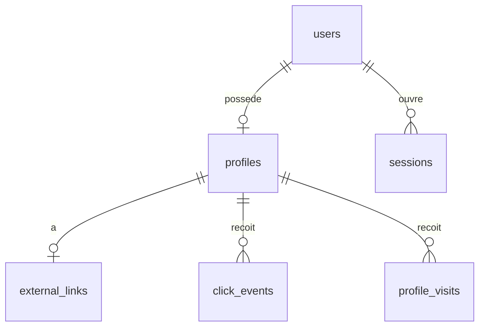

# Schéma de base de données — ProfileLink

> **Statut : proposition en attente de validation (phase 1).** PostgreSQL 18, SQLAlchemy 2.x async, migrations Alembic uniquement.
> La table `sessions` et le type `TIMESTAMPTZ` sont des ajouts au brief : voir [ARCHITECTURE.md](ARCHITECTURE.md#6-écarts-par-rapport-au-brief).

## Diagramme



Conventions communes :

- Clés primaires `UUID` générées par `gen_random_uuid()`.
- Horodatages en `TIMESTAMPTZ`, UTC en base.
- `updated_at` géré par SQLAlchemy (`onupdate`).

## Tables

### `users`

| Colonne | Type | Contraintes |
|---|---|---|
| `id` | UUID | PK |
| `email` | VARCHAR(254) | `NOT NULL`, `UNIQUE`, `CHECK (email = lower(email))` |
| `password_hash` | VARCHAR(255) | `NOT NULL`, Argon2id |
| `is_active` | BOOLEAN | `NOT NULL DEFAULT true` |
| `created_at` | TIMESTAMPTZ | `NOT NULL DEFAULT now()` |
| `updated_at` | TIMESTAMPTZ | `NOT NULL DEFAULT now()` |

`is_active = false` bloque la connexion et rend le profil indisponible publiquement. C'est le levier de suspension d'un compte ; il n'a pas d'interface en v1.

### `sessions` *(ajout)*

| Colonne | Type | Contraintes |
|---|---|---|
| `id` | UUID | PK |
| `user_id` | UUID | `NOT NULL`, FK `users(id) ON DELETE CASCADE` |
| `token_hash` | CHAR(64) | `NOT NULL`, `UNIQUE` |
| `created_at` | TIMESTAMPTZ | `NOT NULL DEFAULT now()` |
| `expires_at` | TIMESTAMPTZ | `NOT NULL` |

Seul le SHA-256 du jeton est stocké : une fuite de la base ne donne pas de session utilisable. Un hachage rapide suffit, car le jeton fait 256 bits aléatoires. Les sessions expirées sont purgées à chaque connexion, sans tâche planifiée.

### `profiles`

| Colonne | Type | Contraintes |
|---|---|---|
| `id` | UUID | PK |
| `user_id` | UUID | `NOT NULL`, `UNIQUE`, FK `users(id) ON DELETE CASCADE` |
| `username` | VARCHAR(30) | `NOT NULL`, `UNIQUE`, `CHECK (username ~ '^[a-z0-9][a-z0-9_-]{2,29}$')` |
| `first_name` | VARCHAR(100) | |
| `last_name` | VARCHAR(100) | |
| `bio` | TEXT | `CHECK (char_length(bio) <= 500)` |
| `photo_url` | TEXT | |
| `is_active` | BOOLEAN | `NOT NULL DEFAULT true` |
| `created_at` | TIMESTAMPTZ | `NOT NULL DEFAULT now()` |
| `updated_at` | TIMESTAMPTZ | `NOT NULL DEFAULT now()` |

- La ligne est créée dans la même transaction que le compte.
- La regex exclut les points et le `_` initial : `robots.txt`, `_next` ou le paramètre interne `__shell__` ne peuvent pas être des usernames.
- Les noms réservés sont vérifiés dans l'application, pour rester modifiables sans migration : `login`, `register`, `dashboard`, `api`, `r`, `admin`, `www`, `media`, `static`, `support`, `help`, `about`, `contact`, `terms`, `privacy`, `settings`, `profil`, `profilelink`.

### `external_links`

| Colonne | Type | Contraintes |
|---|---|---|
| `id` | UUID | PK |
| `profile_id` | UUID | `NOT NULL`, `UNIQUE`, FK `profiles(id) ON DELETE CASCADE` |
| `destination_url` | TEXT | `NOT NULL`, `CHECK (char_length(destination_url) <= 2048)` |
| `is_active` | BOOLEAN | `NOT NULL DEFAULT true` |
| `created_at` | TIMESTAMPTZ | `NOT NULL DEFAULT now()` |
| `updated_at` | TIMESTAMPTZ | `NOT NULL DEFAULT now()` |

`UNIQUE` sur `profile_id` : un seul lien par profil, comme le spécifie le brief. C'est le seul stockage de la destination.

### `click_events`

| Colonne | Type | Contraintes |
|---|---|---|
| `id` | UUID | PK |
| `profile_id` | UUID | `NOT NULL`, FK `profiles(id) ON DELETE CASCADE` |
| `clicked_at` | TIMESTAMPTZ | `NOT NULL DEFAULT now()` |
| `referer_domain` | VARCHAR(253) | Domaine seul, sans chemin |
| `user_agent` | TEXT | Tronqué à 512 caractères par l'application |
| `ip_hash` | CHAR(64) | HMAC-SHA256 |

### `profile_visits`

| Colonne | Type | Contraintes |
|---|---|---|
| `id` | UUID | PK |
| `profile_id` | UUID | `NOT NULL`, FK `profiles(id) ON DELETE CASCADE` |
| `visited_at` | TIMESTAMPTZ | `NOT NULL DEFAULT now()` |
| `referer_domain` | VARCHAR(253) | Domaine seul, sans chemin |
| `user_agent` | TEXT | Tronqué à 512 caractères par l'application |
| `ip_hash` | CHAR(64) | HMAC-SHA256 |

Les colonnes de contexte des événements sont nullables : le `Referer` est souvent absent, et une purge future pourra les vider sans perdre les compteurs.

## Index

Les contraintes `UNIQUE` ci-dessus créent déjà leurs index. S'y ajoutent :

| Index | Colonnes | Usage |
|---|---|---|
| `ix_click_events_profile_time` | `(profile_id, clicked_at DESC)` | Totaux, séries, historique |
| `ix_profile_visits_profile_time` | `(profile_id, visited_at DESC)` | Totaux, séries |
| `ix_sessions_user_id` | `(user_id)` | Déconnexion globale, purge |
| `ix_sessions_expires_at` | `(expires_at)` | Purge des sessions expirées |
| `ix_profiles_active_updated` | `(updated_at) WHERE is_active` | `sitemap.xml` |

## Suppressions

Tout descend de `users` par `ON DELETE CASCADE` :

```text
users ─┬─▶ sessions
       └─▶ profiles ─┬─▶ external_links
                     ├─▶ click_events
                     └─▶ profile_visits
```

Supprimer un lien (`DELETE /owner/links/{id}`) conserve les clics : ils sont rattachés au profil, pas au lien. Le fichier photo n'est pas couvert par la cascade : le service le supprime lors d'un remplacement.

## Statistiques

Calculées à la demande sur les tables d'événements, sans table agrégée :

```sql
SELECT date_trunc('day', clicked_at AT TIME ZONE 'Indian/Antananarivo') AS bucket, count(*)
FROM click_events
WHERE profile_id = :id AND clicked_at >= :from AND clicked_at < :to
GROUP BY bucket;
```

Les périodes sont découpées dans le fuseau de Madagascar, fixe en v1. L'index couvrant suffit pour ces volumes ; une table agrégée ne se justifiera que si ces requêtes ralentissent réellement.

## Données sensibles

| Donnée | Traitement |
|---|---|
| Mot de passe | Argon2id via `argon2-cffi`, jamais en clair ni dans les logs |
| Jeton de session | SHA-256 en base, valeur brute uniquement dans le cookie |
| IP du visiteur | Jamais stockée. `HMAC-SHA256(IP_HASH_KEY, ip)` : un simple SHA-256 d'une IPv4 s'inverse par force brute |
| `ip_hash` | Jamais renvoyé par l'API, y compris au propriétaire |
| `destination_url` | Absente des logs et des réponses publiques |

La durée de conservation de `ip_hash` et `user_agent` reste à arrêter : voir le risque « Données personnelles » dans [ARCHITECTURE.md](ARCHITECTURE.md#7-risques).

## Migrations

- Tout changement de schéma passe par une révision Alembic relue, jamais par `create_all`.
- Appliquées au démarrage du conteneur backend, avant uvicorn.
- `alembic upgrade head` est testé sur une base vide en CI locale, suivi d'un `alembic check` pour détecter tout écart avec les modèles.
