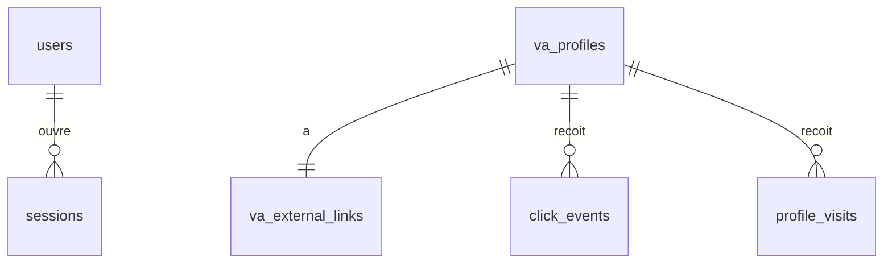

# Schéma de base de données — ProfileLink

> **Statut : implémenté, migrations `0001` à `0003`.**
> PostgreSQL 18, SQLAlchemy 2.x async, migrations Alembic uniquement.

## Diagramme



`users` et `va_profiles` ne sont **pas reliées** : un VA n'a ni compte, ni mot de passe, ni session.

Conventions communes :

- Clés primaires `UUID` générées par `gen_random_uuid()`.
- Horodatages en `TIMESTAMPTZ`, UTC en base.
- `updated_at` géré par SQLAlchemy (`onupdate`).

## Tables

### `users`

Comptes administrateurs uniquement. Structure inchangée.

| Colonne | Type | Contraintes |
|---|---|---|
| `id` | UUID | PK |
| `email` | VARCHAR(254) | `NOT NULL`, `UNIQUE`, `CHECK (email = lower(email))` |
| `password_hash` | VARCHAR(255) | `NOT NULL`, Argon2id |
| `is_active` | BOOLEAN | `NOT NULL DEFAULT true` |
| `created_at` | TIMESTAMPTZ | `NOT NULL DEFAULT now()` |
| `updated_at` | TIMESTAMPTZ | `NOT NULL DEFAULT now()` |

### `sessions`

Sessions administrateur. Structure inchangée.

| Colonne | Type | Contraintes |
|---|---|---|
| `id` | UUID | PK |
| `user_id` | UUID | `NOT NULL`, FK `users(id) ON DELETE CASCADE` |
| `token_hash` | CHAR(64) | `NOT NULL`, `UNIQUE` |
| `created_at` | TIMESTAMPTZ | `NOT NULL DEFAULT now()` |
| `expires_at` | TIMESTAMPTZ | `NOT NULL` |

Seul le SHA-256 du jeton est stocké. Les sessions expirées sont purgées à chaque connexion.

### `va_profiles`

| Colonne | Type | Contraintes |
|---|---|---|
| `id` | UUID | PK |
| `username` | VARCHAR(30) | `NOT NULL`, `UNIQUE`, `CHECK (username ~ '^[a-z0-9][a-z0-9_-]{2,29}$')` |
| `first_name` | VARCHAR(100) | `NOT NULL` |
| `last_name` | VARCHAR(100) | `NOT NULL` |
| `age` | SMALLINT | `NOT NULL`, `CHECK (age BETWEEN 1 AND 120)` |
| `instagram_url` | TEXT | `NOT NULL`, `CHECK (char_length(instagram_url) <= 2048)` |
| `photo_url` | TEXT | `NOT NULL` |
| `is_active` | BOOLEAN | `NOT NULL DEFAULT true` |
| `created_at` | TIMESTAMPTZ | `NOT NULL DEFAULT now()` |
| `updated_at` | TIMESTAMPTZ | `NOT NULL DEFAULT now()` |

- `username` est généré à la création puis figé.
- `instagram_url` est privé : il n'est lu que par les endpoints `/admin/*`. Il n'est pas unique (A11).
- La regex exclut les points et le `_` initial : `robots.txt` ou `_next` ne peuvent pas être des usernames.
- Les noms réservés sont vérifiés dans l'application : `about`, `admin`, `api`, `conditions`, `contact`, `dashboard`, `help`, `login`, `media`, `privacy`, `profil`, `profilelink`, `register`, `settings`, `static`, `support`, `terms`, `www`.

### `va_external_links`

| Colonne | Type | Contraintes |
|---|---|---|
| `id` | UUID | PK |
| `va_profile_id` | UUID | `NOT NULL`, `UNIQUE`, FK `va_profiles(id) ON DELETE CASCADE` |
| `destination_url` | TEXT | `NOT NULL`, `CHECK (char_length(destination_url) <= 2048)` |
| `is_active` | BOOLEAN | `NOT NULL DEFAULT true` |
| `created_at` | TIMESTAMPTZ | `NOT NULL DEFAULT now()` |
| `updated_at` | TIMESTAMPTZ | `NOT NULL DEFAULT now()` |

C'est le seul stockage de la destination. Cette table n'est lue que par `/r/{username}` et les endpoints `/admin/*`.

### `click_events`

| Colonne | Type | Contraintes |
|---|---|---|
| `id` | UUID | PK |
| `va_profile_id` | UUID | `NOT NULL`, FK `va_profiles(id) ON DELETE CASCADE` |
| `clicked_at` | TIMESTAMPTZ | `NOT NULL DEFAULT now()` |
| `referer_domain` | VARCHAR(253) | Domaine seul, sans chemin |
| `user_agent` | TEXT | Tronqué à 512 caractères par l'application |
| `ip_hash` | CHAR(64) | HMAC-SHA256 |

### `profile_visits`

| Colonne | Type | Contraintes |
|---|---|---|
| `id` | UUID | PK |
| `va_profile_id` | UUID | `NOT NULL`, FK `va_profiles(id) ON DELETE CASCADE` |
| `visited_at` | TIMESTAMPTZ | `NOT NULL DEFAULT now()` |
| `referer_domain` | VARCHAR(253) | Domaine seul, sans chemin |
| `user_agent` | TEXT | Tronqué à 512 caractères par l'application |
| `ip_hash` | CHAR(64) | HMAC-SHA256 |

Les colonnes de contexte sont nullables : le `Referer` est souvent absent, et une purge future pourra les vider sans perdre les compteurs.

## Index

Les contraintes `UNIQUE` créent déjà leurs index. S'y ajoutent :

| Index | Colonnes | Usage |
|---|---|---|
| `ix_click_events_profile_time` | `(va_profile_id, clicked_at DESC)` | Statistiques par VA |
| `ix_click_events_time` | `(clicked_at DESC)` | Statistiques globales |
| `ix_profile_visits_profile_time` | `(va_profile_id, visited_at DESC)` | Statistiques par VA |
| `ix_profile_visits_time` | `(visited_at DESC)` | Statistiques globales |
| `ix_sessions_user_id` | `(user_id)` | Révocation |
| `ix_sessions_expires_at` | `(expires_at)` | Purge |

## Suppressions

```text
users ─▶ sessions

va_profiles ─┬─▶ va_external_links
             ├─▶ click_events
             └─▶ profile_visits
```

Supprimer un VA efface définitivement son lien et ses statistiques (A8). Le fichier photo n'est pas couvert par la cascade : le service le supprime explicitement.

## Migration `0002`

Passage de l'ancien modèle au schéma actuel.

1. **Garde-fou :** la migration s'arrête avec une erreur si `users` ou `profiles` contient des lignes.
   - Tout compte existant deviendrait administrateur.
   - Aucun âge ni email ne peut être inventé pour un profil existant.
2. `va_profiles` et `va_external_links` sont créées, `profiles` et `external_links` supprimées. Les tables étant vides, c'est plus simple et plus sûr que des renommages.
3. `click_events` et `profile_visits` passent à `va_profile_id`, avec leurs index globaux.

Le `downgrade` restaure la structure de `0001`, et refuse de s'exécuter si `va_profiles` contient des lignes.

Le garde-fou a fonctionné le 2026-11-06 sur la base de développement `profilelink`, qui contenait un compte de test. Cette base a été laissée intacte, et le développement utilise `profilelink_va`.

Règles générales :

- Tout changement passe par une révision Alembic relue, jamais par `create_all`.
- Les migrations s'appliquent au démarrage du conteneur backend, avant uvicorn.
- Les tests vérifient l'aller-retour, `alembic check` et les garde-fous.

## Migration `0003`

Remplace `email` par `instagram_url` dans `va_profiles`. Elle s'arrête si la table contient des lignes dans un sens comme dans l'autre, car l'une des valeurs ne peut pas être déduite de l'autre.

## Statistiques

Calculées à la demande sur les tables d'événements, sans table agrégée. Les périodes sont découpées dans le fuseau de Madagascar.

```sql
SELECT date_trunc('day', clicked_at AT TIME ZONE 'Indian/Antananarivo') AS bucket, count(*)
FROM click_events
WHERE clicked_at >= :from AND clicked_at < :to
  -- AND va_profile_id = :va_id   si un VA est sélectionné
GROUP BY bucket;
```

## Données sensibles

| Donnée | Traitement |
|---|---|
| Mot de passe administrateur | Argon2id, jamais en clair ni dans les logs |
| Jeton de session | SHA-256 en base, valeur brute uniquement dans le cookie |
| IP du visiteur | Jamais stockée. `HMAC-SHA256(IP_HASH_KEY, ip)` |
| `ip_hash` | Jamais renvoyé par l'API |
| `destination_url` | Absente des logs et des réponses publiques |
| Âge du VA | Public sur sa page par décision produit, absent d'Open Graph, page en `noindex` |
| `instagram_url` | Dashboard uniquement, absent de toute réponse publique |
| Email administrateur | Jamais renvoyé par une route publique |

La durée de conservation de `ip_hash` et `user_agent` reste à arrêter avec un juriste.
